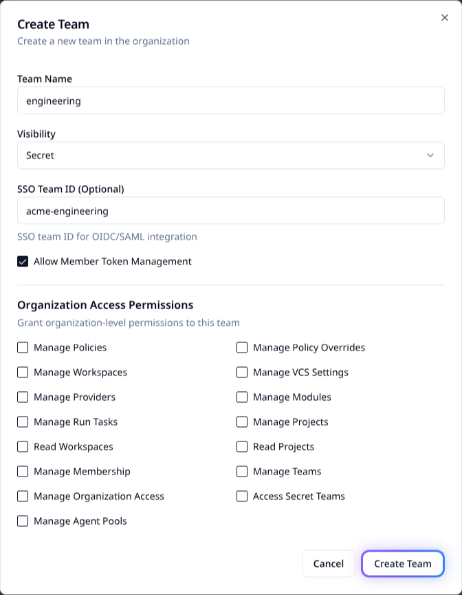

# Map SSO groups to teams

Map an external group to a Stackweaver team by setting the team's **SSO Team ID** to the
exact value emitted by your identity provider. A successful match can add both team and
parent-organization membership.

> [!WARNING]
> Do not use team sync as your sole offboarding control. Empty or missing groups do not
> reliably clear stored memberships, even with removal enabled. Revoke access explicitly
> and verify it when removing a person's last external group.

## Before you enable automatic access

You need working external SSO and permission to manage teams. Verify the actual group
value using a nonprivileged test account. Entra commonly emits group Object IDs; Okta
commonly emits names. Exact values and case matter.

Mappings are globally unique and match across organizations. They are not namespaced by
identity provider or tenant. If two providers emit the same group name, they can match the
same team. Use distinct values under your control and review every mapping's permissions.

## 1. Enable synchronization

### Docker Compose

Save these API settings in persistent `sso.env`, beside the Compose file:

```dotenv
ENABLE_OIDC_TEAM_SYNC=true
OIDC_REMOVE_FROM_NON_SSO_TEAMS=false
```

Apply them with `docker compose up -d api`. Runtime defaults are `false`; the checked-in
`sso.env.example` explicitly enables team sync, so inspect the file you actually deploy.

The two Zitadel Actions targets must reach the API **from Zitadel's network**. For the
bundled bridge-network Compose deployment, set this initializer environment override in
your installed Compose configuration before creating targets:

```yaml
services:
  zitadel-init:
    environment:
      ACTIONS_API_BASE_URL: http://api:8022
```

Use your deployment's real service address. A localhost address inside the Zitadel
container points to Zitadel itself. With the stack running, run
`docker compose run --rm zitadel-init` and inspect the targets in Zitadel. While the API's
host does not resolve, as on a first install where the API starts after the initializer, the
initializer creates the targets at a holding address on Zitadel itself and the next run moves
them to this address. When the variable is set, each run moves existing targets to this
address and keeps their signing keys, so after changing it, run the initializer again and test
delivery. Without it, existing targets keep the address they have.

### Kubernetes / Helm

Merge into `my-values.yaml` and apply to the existing release:

```yaml
sso:
  enableOidcTeamSync: true
  oidcRemoveFromNonSsoTeams: false
```

Set `STACKWEAVER_CHART_VERSION` locally to the installed chart version shown by
`helm list --namespace stackweaver`. Preserve your release values; changing identity or VCS
settings is not an instruction to upgrade the platform.

```bash
helm upgrade stackweaver oci://ghcr.io/vhco-pro/charts/stackweaver \
  --version "${STACKWEAVER_CHART_VERSION:?Set the installed chart version}" \
  --namespace stackweaver --values my-values.yaml
```

The chart supplies the in-cluster API address for Actions. Check the release's actual target
URLs and successful delivery; configured targets alone do not establish synchronization.

## 2. Configure the team

Choose the UI, Terraform/OpenTofu provider or API. Deployment YAML enables the service;
it does not declare team resources. There is no Stackweaver CLI procedure for this task.

### In the UI

1. Open **Settings > Users**, then the **Teams** tab.
2. Choose **Create Team**, or edit an existing team.
3. Set **SSO Team ID (Optional)** to the exact emitted group value.
4. Grant only the needed permissions, save and reopen the team to check the value.



### With Terraform or OpenTofu

Use the [native provider](../terraform-provider.md) with a token allowed to manage teams:

```hcl
terraform {
  required_providers {
    stackweaver = {
      source = "vhco-pro/stackweaver"
    }
  }
}

provider "stackweaver" {
  hostname = "stackweaver.example.com"
}

resource "stackweaver_team" "engineering" {
  name         = "engineering"
  organization = "my-org"
  sso_team_id  = "acme-engineering"
}
```

Supply `TFE_TOKEN` securely, run `terraform init`, review `terraform plan` and apply only the
intended team change. Inspect the saved mapping. The TFE-compatible `tfe_team.sso_team_id`
path remains available for existing configurations; do not manage the same team twice.

### Through the API

Save as `team-mapping.json`, replacing both the team ID and emitted group value:

```json
{
  "data": {
    "type": "teams",
    "id": "team-example",
    "attributes": { "sso-team-id": "acme-engineering" }
  }
}
```

With `STACKWEAVER_URL`, a `tfe-` API token in `STACKWEAVER_TOKEN`, and `TEAM_ID` set locally:

```bash
curl --fail-with-body --silent --show-error \
  --request PATCH "$STACKWEAVER_URL/api/v2/teams/$TEAM_ID" \
  --header "Authorization: Bearer $STACKWEAVER_TOKEN" \
  --header 'Content-Type: application/vnd.api+json' \
  --data-binary @team-mapping.json
```

Check the returned `sso-team-id` and reopen the team. A duplicate-value error means another
team already owns that mapping; investigate instead of reusing a broad shared group.

## 3. Verify the access chain

1. Sign in through the provider using a test account with the intended group.
2. Verify successful IDP-sync and complement-token webhook delivery in Zitadel/API logs.
3. Confirm the complement-token action runs for access tokens issued to **Stackweaver BFF**
   and emits the intended nonempty `sso_groups` claim at sign-in. Use webhook delivery and API
   logs plus resulting membership as evidence; the browser exposes no OAuth token to inspect.
4. Make a normal authenticated API request and check team and organization membership.
5. Test a user outside that group and confirm they do not gain the mapped access.

The IDP-sync action captures groups; the complement-token action adds stored groups to
the access token that the API verifies during sign-in. The API then discards that token.
Team synchronization runs at sign-in with a nonempty group list. API-token requests
follow a different authentication path and do not resynchronize teams.
A new account's first-sign-in path does not guarantee group metadata transfer; verify the
issued claims and membership rather than promising immediate first-login assignment.

Existing browser sessions are not resynchronized after a group change. Ask the user to sign
out and sign back in. A fresh sign-in is required when the session reaches its maximum
lifetime, twelve hours by default; the identity provider must also return the updated groups.
API tokens do not trigger SSO group synchronization.

## Understand removal before using it

| Input and setting | Effect |
|---|---|
| Team sync disabled. | No automatic team synchronization. |
| Nonempty groups, removal disabled. | Add matching team and organization memberships. |
| Nonempty groups, removal enabled. | Also remove memberships from mapped teams absent from that list. |
| Empty or missing groups. | Sync is skipped; previously stored groups/memberships can survive. |
| Unmapped team or organization membership. | Removal does not delete the user, remove organization membership or change unmapped teams. |

Enable removal only after testing, using `OIDC_REMOVE_FROM_NON_SSO_TEAMS=true` or
`sso.oidcRemoveFromNonSsoTeams: true`. For example, a refreshed list containing
`acme-engineering` but not `acme-security` can remove the security-team membership. An
empty list does not provide the same guarantee. Sync errors can be logged without blocking
sign-in, so successful authentication is not proof of correct authorization.

## Find the emitted group identifier

| Provider | Where to check | Common value |
|---|---|---|
| Entra ID. | **Groups > group > Object ID**, plus the app's token group configuration. | Group Object ID, not display name. |
| Okta. | **Directory > Groups**, then the custom-server Token Preview. | Exact group name in the documented groups claim. |
| Cognito. | User pool **Groups**, then the upstream token. | Group name in `cognito:groups`. |
| Keycloak. | Realm group and the client's Group Membership mapper. | Name or full path, according to `full_path`. |

The token is the authority for matching. Portal labels alone do not show whether a mapper
emits names, IDs or paths.

## Read the diagnostic logs

These are read-only checks. Run them after signing in with the test account and making an
authenticated API request. Use the release's actual Deployment names and namespace.

::: code-group
```bash [Docker Compose]
docker compose logs --tail=200 api | rg -i 'teamsync|idp sync webhook|complement token webhook'
docker compose logs --tail=200 zitadel-init | rg -i 'actions v2|target|set execution'
```
```bash [Kubernetes]
kubectl logs deployment/stackweaver-api --namespace stackweaver --tail=200 | rg -i 'teamsync|idp sync webhook|complement token webhook'
kubectl logs deployment/stackweaver-zitadel --namespace stackweaver -c zitadel-init --tail=200 | rg -i 'actions v2|target|set execution'
```
:::

The examples use `rg` (ripgrep); use your usual log-search tool if it is not installed.
The Compose initializer log line applies to a retained service container. If you used
`docker compose run --rm zitadel-init`, inspect that command's output instead; its removed
one-off container does not leave logs for this check.

| Evidence | What it establishes |
|---|---|
| IDP-sync webhook receives a request and extracts groups. | The upstream claim reached group capture. |
| Complement-token webhook runs. | Check its result and the issued `sso_groups` claim. |
| TeamSync finds/adds the expected team. | Check actual team and organization membership afterward. |
| Target/execution configuration messages. | The initializer configured bindings; successful delivery is a separate check. |

Redact tokens and private user/group information before sharing logs.

## Troubleshoot the failing link

| Symptom | Next check |
|---|---|
| No `sso_groups`. | Provider's actual claims, target reachability and webhook delivery; then sign out and sign back in. |
| Claim present, membership missing. | Team-sync setting, exact mapping, API logs and request authentication type. |
| Membership persists after removal. | Check whether the fresh list is empty or stale. Remove access explicitly if required. |
| Unexpected organization access. | Audit all mapped teams and repeated group values across identity providers. |

Group capture uses the first nonempty supported claim, rather than merging all claims:
`groups`, `cognito:groups`, `roles`, `group`, then `realm_access.roles`. Inspect which one
actually wins. See the [Entra](./azure-ad.md), [Okta](./okta.md),
[generic OIDC](./generic-oidc.md) and [Cognito compatibility](./aws-cognito.md) guides.
