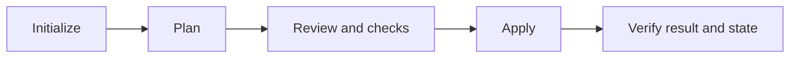

# Read OpenTofu runs

A run records an OpenTofu execution against a workspace. Review its configuration and plan
before approving changes, then check the apply result and state. Plan and apply are phases
of a run, not interchangeable signs that the work is finished.

## Choose the run type

Open the workspace and select **New run**. Choosing Plan & Apply or Plan Only queues it;
Destroy opens a separate confirmation first.


| Choice | What happens |
|---|---|
| Plan & Apply. | Create a plan, then wait for apply confirmation unless auto-apply is enabled. |
| Plan Only. | Create a plan that cannot subsequently be applied. |
| Destroy. | Plan removal of all managed resources, subject to the workspace's destroy permission and confirmation. |

> [!WARNING]
> Auto-apply also applies to destroy runs. Once the destroy plan finishes, resources can
> be removed without a second approval. The dialog requires the exact workspace name
> before it will queue a destroy; check the workspace and auto-apply setting first.

**Allow destroy plans** controls whether the workspace accepts destroy runs. When disabled,
the UI explains the refusal and the API rejects a destroy request with `422`. It does not
block normal plan or apply runs.

Plan-only is an apply restriction, not a sandbox for untrusted configuration. Provider
reads, external programs and other planning-time behavior still run with the available
network access and credentials.

## Review the plan

1. Check the workspace, configuration version/commit, trigger and time. Do not approve
   a plan from an unintended branch or stale configuration.
2. Read the add/change/destroy totals. Investigate unexpected deletions and replacements.
3. Expand affected resources to inspect the attribute changes and warnings.
4. If structured output is incomplete, open **View Raw Output** and inspect the terminal
   or JSON representation.
5. Approve only after the plan and any required external checks are acceptable.

OpenTofu's diff notation distinguishes changes from actions already performed:

```text
~ resource "aws_instance" "example" {
    ~ instance_type = "t2.micro" -> "t2.small"
  }
```

This plan proposes changing `instance_type`; it does not prove that the change was applied.
A replacement can include both a create and a destroy action.

## Follow checks and the apply



<details>
<summary>What the phases mean</summary>

- Initialization prepares the configuration, modules and providers.
- Planning computes the proposed changes. Plan-only runs finish without an apply.
- Review includes required run-task stages and manual approval where configured.
- Applying changes real resources; the output records progress and failures.
- Verification checks the terminal result, outputs and recorded state version.

</details>

[Run tasks](./run-tasks.md) can pause at configured stage boundaries. Advisory failures are
informational; mandatory failures hold the run unless an authorized user overrides them.
Read the finding before choosing an override.

During apply, follow resource progress and expand failures. Afterward, confirm the final
status and review the saved outputs and state version. A failed apply may have changed
some resources already; do not assume it rolled everything back.

## Inspect a run through the API

For automation, use read requests with a token allowed to access that workspace. Set
`STACKWEAVER_URL`, `STACKWEAVER_TOKEN` and the actual `RUN_ID` locally:

```bash
curl --fail-with-body --silent --show-error \
  "$STACKWEAVER_URL/api/v2/runs/$RUN_ID" \
  --header "Authorization: Bearer $STACKWEAVER_TOKEN"
```

Inspect `data.attributes.status` and the related workspace/plan information. Retrieve saved
outputs separately:

```bash
curl --fail-with-body --silent --show-error \
  "$STACKWEAVER_URL/api/v2/runs/$RUN_ID/outputs" \
  --header "Authorization: Bearer $STACKWEAVER_TOKEN"
```

The [API viewer](/docs/api-reference/explorer) documents creation, actions and output
schemas. Terraform/OpenTofu CLI remote execution can also queue plans through the
workspace's configured backend; see [your first workspace](../get-started/your-first-opentofu-workspace.md).
The management provider configures workspace behavior, not an equivalent YAML run record.
Do not invent a repository YAML definition for reviewing a run.

## Investigate a failure

| Where it stopped | Start here |
|---|---|
| Queued. | Runner availability, routing and workspace lock. |
| Initialization or plan. | Raw output, selected configuration, provider/version and credentials. |
| Waiting for confirmation/checks. | Plan review, run-task findings and the required permission. |
| Apply. | First meaningful provider/resource error and any partial changes. |
| Result differs from an earlier run. | Compare commits, inputs, provider lock files, state versions and output. |

Use the workspace's run history to open a known successful run and compare the same fields.
Keep run IDs and redacted error text for support. See [troubleshooting](./troubleshooting-common-issues.md),
[variables](./managing-workspace-variables.md) and [VCS path filtering](../features/opentofu/vcs-path-filtering.md)
for the next diagnostic step.
