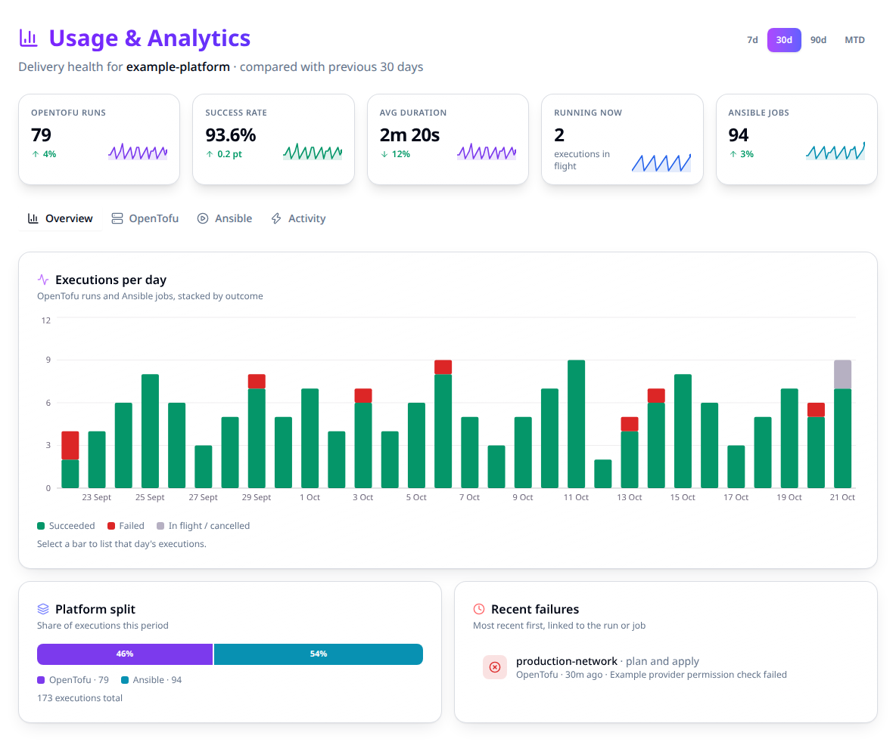

# Read usage and analytics

Use **Usage** to find failed automation and compare delivery health for one organization.
Start with the organization and date range, then follow a failure or chart segment to the
run or job that needs attention.

## Open the right scope

1. Select the organization in the application header.
2. Open **Usage** from the sidebar.
3. Choose **7d**, **30d**, **90d** or month to date. Check the comparison period in the header.

You need owners-team access, permission to view all workspaces or all projects, or the
organization API token. Ordinary membership alone is insufficient because the page spans
the organization's projects and workspaces.



## Read the headline figures

| Figure | Meaning |
|---|---|
| Run/job count. | Executions created within the selected period. |
| Success rate. | Successful outcomes divided by successful plus failed outcomes. Pending, running and canceled executions are excluded. |
| Duration. | Timing of successfully completed executions with valid start/end timestamps. The platform tabs also show p95 and sample count. |
| In flight. | Executions running **now**, across the organization, independent of the historical date range. |
| Change indicator. | Comparison with the immediately preceding period of equal length. |

A dash for success rate or duration means there is no applicable result to measure; it is
not a zero-percent success rate. An empty period is different from a load error, which
shows an explicit error and retry control.

## Find the failing execution

1. On **Overview**, inspect daily outcomes and **Recent failures**.
2. Open a recent failure to go directly to its run or job, or select a daily chart segment.
3. In the day panel, check the selected platform and outcome. A red segment opens failures
   for that day; available outcome buttons let you widen the selection.
4. Follow the execution link and inspect its output before retrying or changing settings.

The panel offers only outcomes present that day. Mixed-platform days have separate,
collapsible OpenTofu and Ansible sections. A busy day shows at most the latest hundred
matching executions and says when the list is truncated.

## Choose a tab

| Tab | Use it for |
|---|---|
| Overview. | Daily combined volume, platform split and recent failures. |
| OpenTofu. | Run outcomes, average/p95 duration and busiest workspaces. |
| Ansible. | Job outcomes, average/p95 duration, busiest templates and current automation assets. Ad hoc jobs are excluded from template rankings. |
| Activity. | Recorded audit events, grouped by date, action and resource type. |

A plan-only run at `planned` counts as successful. A plan-and-apply run at `planned` is
still pending confirmation. OpenTofu `applied`/`completed` and Ansible `successful` count
as successful outcomes; Ansible `failed` and `error` count as failures.

Date filters bound historical execution and audit metrics. **In flight** and current asset
counts describe the present state, so do not expect them to fall to zero when viewing an
old period.

## Read the same metrics through the API

This page is read-only. There is no management HCL or repository YAML to configure these
figures, and no Stackweaver CLI command for the view. Use an authorized API token for
exports or external reporting.

Set `STACKWEAVER_URL` to your public origin and `STACKWEAVER_TOKEN` securely. Replace
`my-org` and the UTC RFC3339 dates. The start is inclusive and the end is exclusive;
keep the range at most 400 days.

```bash
curl --fail-with-body --silent --show-error --get \
  "$STACKWEAVER_URL/api/v2/organizations/my-org/analytics" \
  --header "Authorization: Bearer $STACKWEAVER_TOKEN" \
  --data-urlencode 'since=2026-10-01T00:00:00Z' \
  --data-urlencode 'until=2026-10-08T00:00:00Z'
```

Expect a JSON:API response with `data.attributes.window`, run/job outcomes, daily points,
activity, current resources and `running_now`. Preserve nullable rates in your reporting.
The `/analytics/executions` endpoint accepts the same time bounds plus optional `platform`
(`terraform` or `ansible`) and `outcome` (`succeeded`, `failed` or `other`) for drill-down.
See the [API viewer](/docs/api-reference/explorer) for full schemas.

## When a number looks wrong

Check the organization, UTC boundaries and whether you are comparing historical totals
with a live figure. Then inspect the underlying executions and their decided outcomes.
Retry an explicit load error; do not interpret it as an idle organization. For execution
failures, use [common troubleshooting](./troubleshooting-common-issues.md).
