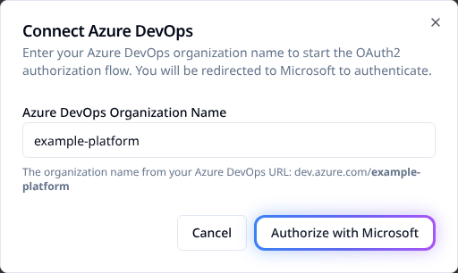

# Connect Azure DevOps repositories

Connect an Azure DevOps organization so workspaces can read repositories and respond to
pushes and pull requests. The connection uses Microsoft Entra OAuth and is separate from
[Entra browser SSO](../sso/azure-ad.md).

## Before you start

You need an Azure DevOps organization with a Git repository, access to that organization
and permission to register an Entra application. In Stackweaver, you need organization-owner
or **Manage VCS settings** access. An organization API token initiating installation needs
write scope on that organization.

Choose the public app URL and API URL first. Microsoft must be able to redirect your
browser to the app, and Azure DevOps must be able to deliver hooks to the API.

| URL | Purpose |
|---|---|
| `https://app.example.com/vcs/azure-devops/callback` | Entra redirect for this VCS connection. |
| `https://app.example.com/api/v2/vcs-connections/azure-devops/webhook` | Service-hook receiver when the API is routed under the app origin. |
| `https://auth.example.com/idps/callback` | External SSO callback; do not use it for the VCS connection. |

## 1. Register the Entra application

Use the manual steps below or the [Terraform template](#terraform-setup). Both configure
the identity application; neither replaces a user's Azure DevOps authorization.

1. In the [Azure Portal](https://portal.azure.com), open **Microsoft Entra ID > App registrations > New registration**.
2. Name the app and select the intended account audience. Choose a single tenant for a
   single-directory installation; use multiple tenants only when that is intended.
3. Register the public VCS callback as a **Web** redirect URI. A local development URI is
   a separate allowed entry:

   ```text
   http://localhost:5173/vcs/azure-devops/callback
   ```
4. Record the client ID and, for single-tenant mode, directory/tenant ID.
5. Under **API permissions**, add the Azure DevOps delegated permissions below. Consent
   is subject to your tenant policy; an administrator may need to approve it.
6. Under **Certificates & secrets**, create a client secret, record the expiry and copy
   its **value** immediately. The secret ID is not the credential.

| Permission | Used for |
|---|---|
| `vso.code` | Repository/code access, including inherited service-hook access. |
| `vso.code_status` | Commit and pull-request status checks. |
| `vso.project` | Project/repository listing. |

The connection also requests `offline_access` for refresh tokens. Do not add separate
`vso.hooks` or `vso.hooks_write` scopes to this request. Use the
[documented Azure DevOps scope hierarchy](https://learn.microsoft.com/en-us/azure/devops/integrate/get-started/authentication/oauth?view=azure-devops#available-scopes)
and the [Entra OAuth guide](https://learn.microsoft.com/en-us/azure/devops/integrate/get-started/authentication/entra-oauth)
when reviewing consent.

If Azure DevOps does not appear as an API, an Entra administrator can check its enterprise
application with Azure CLI:

```bash
az ad sp show --id 499b84ac-1321-427f-aa17-267ca6975798
```

Only if that principal is absent, provision it in the intended tenant:

```bash
az ad sp create --id 499b84ac-1321-427f-aa17-267ca6975798
```

## 2. Configure the deployment

### Docker Compose

Save persistent credentials in `vcs.env`, beside the Compose file. Replace placeholders,
keep the file private and use a strong, independently generated webhook secret.

```dotenv
AZURE_DEVOPS_CLIENT_ID=replace-with-client-id
AZURE_DEVOPS_CLIENT_SECRET=replace-with-secret-value
AZURE_DEVOPS_REDIRECT_URI=https://app.example.com/vcs/azure-devops/callback
AZURE_DEVOPS_TENANT_ID=replace-with-single-tenant-id
STACKWEAVER_WEBHOOK_BASE_URL=https://app.example.com
AZURE_DEVOPS_WEBHOOK_SECRET=replace-with-strong-webhook-secret
```

Leave `AZURE_DEVOPS_TENANT_ID` unset or set it to `common` only for the intended multitenant
configuration. `STACKWEAVER_WEBHOOK_BASE_URL` is the **public API origin**, without `/api/v2`.
Use a different origin if your API has its own host. Never maintain these values in
auto-generated `.env`.

```bash
docker compose up -d api orchestrator ansible-runner
docker compose logs api
```

### Kubernetes / Helm

The chart's component `env` maps accept string values, not `valueFrom` objects. Merge the
same settings into `api.env`, `orchestrator.env` and `ansibleRunner.env` in a protected
values file. For example, the API portion is:

```yaml
api:
  env:
    AZURE_DEVOPS_CLIENT_ID: "replace-with-client-id"
    AZURE_DEVOPS_CLIENT_SECRET: "replace-with-secret-value"
    AZURE_DEVOPS_REDIRECT_URI: "https://app.example.com/vcs/azure-devops/callback"
    AZURE_DEVOPS_TENANT_ID: "replace-with-single-tenant-id"
    STACKWEAVER_WEBHOOK_BASE_URL: "https://app.example.com"
    AZURE_DEVOPS_WEBHOOK_SECRET: "replace-with-strong-webhook-secret"
```

Repeat under `orchestrator.env` and `ansibleRunner.env`. These values appear in Deployment
specifications and Helm release data; restrict access and do not commit the file. Use your
normal protected deployment process rather than pasting secrets into a shared terminal.

Set `STACKWEAVER_CHART_VERSION` locally to the installed chart version shown by
`helm list --namespace stackweaver`. Preserve your release values; changing identity or VCS
settings is not an instruction to upgrade the platform.

```bash
helm upgrade stackweaver oci://ghcr.io/vhco-pro/charts/stackweaver \
  --version "${STACKWEAVER_CHART_VERSION:?Set the installed chart version}" \
  --namespace stackweaver --values my-values.yaml
kubectl logs deployment/stackweaver-api --namespace stackweaver
```

Use your installed release and Deployment names. The changed values roll the consumers.

## 3. Authorize a connection

1. In the intended Stackweaver organization, open **Settings > VCS Connections**.
2. Select **Connect Azure DevOps**.
3. Enter the organization name from `dev.azure.com/<organization>`, not its full URL.
4. Continue to Microsoft and authorize with an account that can access the target Azure
   DevOps organization.
5. Confirm the browser returns to Stackweaver and the connection appears in the list.



Authorization is interactive. There is no Stackweaver CLI command or repository YAML that
replaces this consent step. API integrations can initiate the same browser flow:

```bash
curl --fail-with-body --silent --show-error --get \
  "$STACKWEAVER_URL/api/v2/organizations/my-org/vcs-connections/azure-devops/install" \
  --header "Authorization: Bearer $STACKWEAVER_TOKEN" \
  --data-urlencode 'ado_org=example-platform' \
  --data-urlencode 'return=/app/my-org/settings/vcs-connections'
```

Set the public origin and authorized token locally, and replace both organization names.
The response's `meta.auth-url` is the authorization destination, not a completed connection.
Follow it in the browser to complete consent and the callback.

## 4. Link a repository and verify hooks

1. Create or edit a workspace. Select the connection, repository and branch.
2. Azure DevOps repository identifiers use `ProjectName/RepositoryName`. Check the working
   directory and speculative-run setting, then save.
3. Inspect **Project settings > Service hooks** in Azure DevOps for that repository.
4. Push a harmless test change to the tracked branch and confirm the expected run.
5. For PR plans, test a pull request and verify the speculative result and commit status.

A connection alone creates no subscriptions. Saving a linked workspace, playbook or
inventory registers hooks for that repository, including an Ansible-only repository.

| Event | Expected behavior |
|---|---|
| Code pushed. | Queue matching workspace runs and sync tracked Ansible playbooks/inventories. |
| Pull request created. | Queue eligible speculative plan-only runs. |
| Pull request updated. | Refresh eligible PR plans after new commits. |

Matching includes the connected Azure DevOps organization as well as repository and branch.
Identical project/repository names in another Azure DevOps organization do not identify
the same connection.

Hook registration requires `AZURE_DEVOPS_WEBHOOK_SECRET`. It uses that value as the
subscription's Basic-auth password; unauthenticated deliveries are rejected. After changing
the secret or public URL, save one linked resource **per repository** to replace its
subscriptions. Otherwise old deliveries can fail with `401`.

### Manual service-hook fallback

If automatic registration is unavailable, use **Project settings > Service hooks > Create subscription > Web Hooks**:

1. Choose **Code pushed** and the specific repository.
2. Set the receiver URL to your public API origin followed by:

   ```text
   /api/v2/vcs-connections/azure-devops/webhook
   ```
3. Use Basic-auth username `stackweaver` and the configured webhook secret as password.
4. Send **All** resource details, with message fields **None**, then test the subscription.
5. Repeat for **Pull request created** and **Pull request updated**.

For local development, use a public tunnel to the API. Azure DevOps cannot reach localhost.
Set `STACKWEAVER_WEBHOOK_BASE_URL` to that public origin, recreate consumers and re-save
linked resources. Do not expose credentials or unrelated local services through the tunnel.

## Terraform setup

The maintained AzureAD template configures the enterprise application, app registration,
delegated permissions and client secret. Download all files from the explorer into a
private working directory and review them before applying.

> [!WARNING]
> The template manages the tenant's shared Azure DevOps enterprise application, reusing
> it when it already exists. Other applications can depend on that service principal.
> Review state ownership before adopting it, and do not destroy this configuration as
> routine Stackweaver cleanup. Check any deletion plan for shared tenant resources.

::: code-explorer ./entra-setup default="main.tf"
:::

Authenticate Azure CLI to the intended tenant, then run from the downloaded directory:

```bash
az login
terraform init
terraform plan -out=azure-devops.tfplan \
  -var='redirect_uris=["https://app.example.com/vcs/azure-devops/callback"]' \
  -var='display_name=Stackweaver'
```

Apply the exact reviewed plan:

```bash
terraform apply azure-devops.tfplan
```

For local plus public callbacks, supply both entries in `redirect_uris` when planning:

```bash
terraform plan -out=azure-devops.tfplan \
  -var='redirect_uris=["https://app.example.com/vcs/azure-devops/callback","http://localhost:5173/vcs/azure-devops/callback"]'
```

The provider also supports
service-principal authentication through `ARM_CLIENT_ID`, `ARM_CLIENT_SECRET` and
`ARM_TENANT_ID`. This template uses the provider's single-tenant application default;
it has no audience input. For a deliberate multitenant setup, adapt the app registration
and review its audience separately. Select the intended management tenant and a suitable
`secret_end_date`; do not assume a template default is your rotation policy.

Retrieve outputs privately, then configure the deployment as above:

```bash
terraform output AZURE_DEVOPS_CLIENT_ID
terraform output -raw AZURE_DEVOPS_CLIENT_SECRET
terraform output AZURE_DEVOPS_TENANT_ID
```

The `-raw` command prints the secret in plain text, and Terraform state contains it.
Protect both. The template is not a verified zero-downtime secret-rotation procedure.
Review its plan for password replacement before changing expiry; do not destroy the
working credential before consumers have a tested replacement.

## Rotate and recover deliberately

Create a replacement secret, update `vcs.env` or the protected Helm values, and recreate
consumers. Verify token exchange and repository access before retiring the old credential.
If using Terraform, manage overlap explicitly and inspect the plan rather than assuming
an expiry edit preserves the old secret.

| Symptom | Check |
|---|---|
| Integration not configured. | Client ID/secret reached the API and workers after recreation. |
| `AADSTS650052`. | Azure DevOps enterprise application exists in the intended Entra tenant. |
| `AADSTS650053` for hooks scope. | Do not explicitly request separate hooks scopes; inspect app permissions and the actual authorization request. |
| Redirect mismatch / `AADSTS50011`. | Exact public callback under the app's **Web** registration and deployment setting. |
| No repositories. | Authorizing account's project access, delegated permissions, organization/tenant connection and activated Entra identity. |
| Azure DevOps `401` or token refresh failure. | Account access, consent, credential expiry and organization policy. Refresh tokens can be revoked. |
| Hook missing or rejected. | Current public API origin, webhook secret, per-repository save and Service Hook delivery result. |
| PR plan/status absent. | Both PR events, speculative setting and `vso.code_status`; existing consent may need renewal after permission changes. |

An organization administrator may need to connect Azure DevOps to the intended Entra
directory and have the user sign into that organization once. Re-authorize only after
checking the cause and resources using the connection; deleting a shared connection is
not the first diagnostic step. Preserve redacted errors and IDs for support.


### Repositories return 403: Identity has not been materialized

1. Confirm you selected the intended Azure DevOps organization and Entra directory.
2. Sign into `https://dev.azure.com/<organization>` once using the **same Entra account**
   that authorizes the Stackweaver connection, then retry repository listing.
3. If the organization is connected to another directory, have its administrator review
   **Organization settings > Microsoft Entra**. A directory change affects that organization;
   do not change it merely to clear an unexplained error.
4. Re-authorize the Stackweaver connection only after the account/directory issue is resolved
   and you have checked the resources using the connection.

### Inspect webhook delivery and PR status

::: code-group
```bash [Docker Compose]
docker compose logs --tail=200 api | rg -i 'azure|webhook'
```
```bash [Kubernetes]
kubectl logs deployment/stackweaver-api --namespace stackweaver --tail=200 | rg -i 'azure|webhook'
```
:::

Check the Service Hook subscription's **Test** result and HTTP response as well as the API
log. A `401` hook response can mean the stored subscription still uses an old webhook secret;
save a linked resource for that repository after applying the current secret.

For missing PR status, check the app's `vso.code_status` delegated permission, current user
consent and both PR hook events. A permission added to the registration does not enlarge
already-issued tokens. Arrange renewed consent/re-authorization after reviewing the shared
connection's dependents, then test a PR and its status result.
