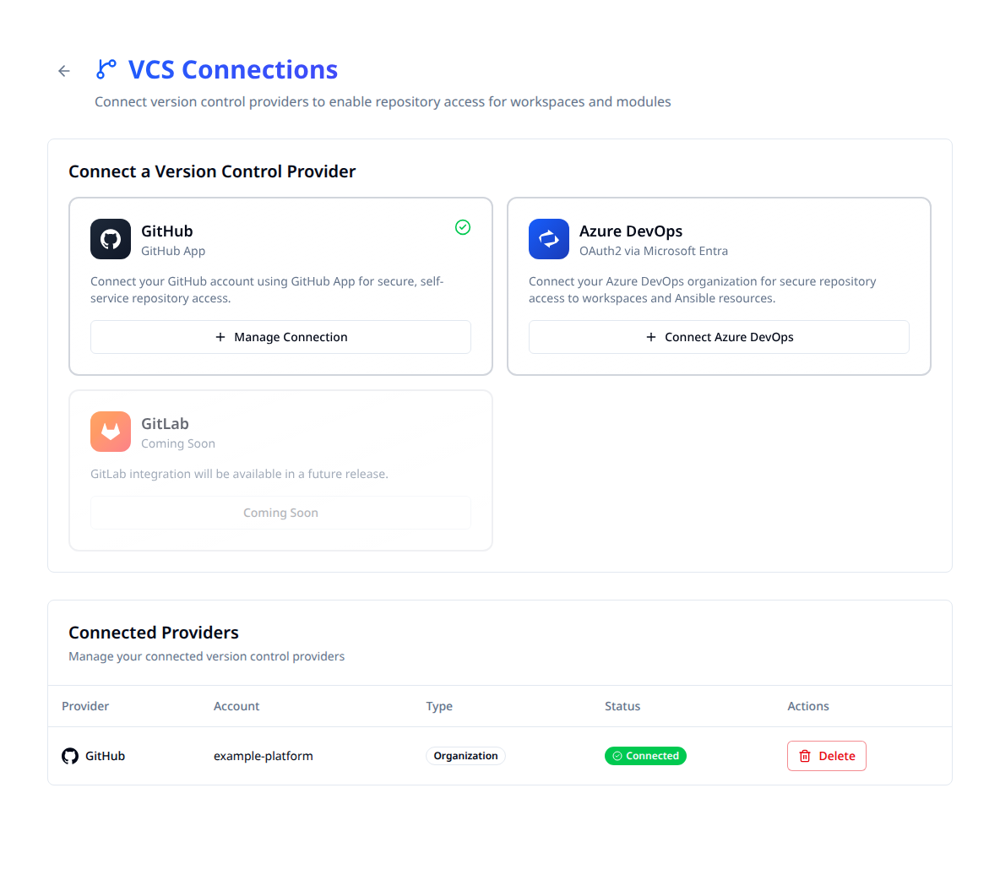
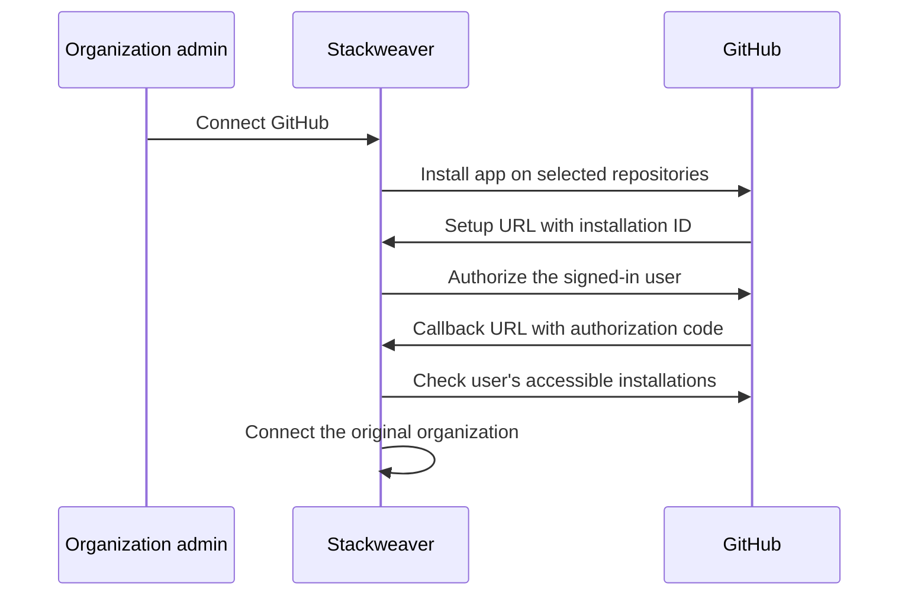

# Connect a GitHub App

Register one GitHub App for your Stackweaver deployment, configure its credentials, then
let organization administrators connect their GitHub installations. GitHub App integration
is separate from browser SSO and from Azure workload identity.

## Before you start

You need access to register or manage the GitHub App and to update your Stackweaver
deployment. Connecting an installation in Stackweaver requires organization ownership or
`manage-vcs-settings` permission. The GitHub account completing authorization must have
access to the installation being connected.

Use your public frontend and API origins throughout. For a local environment, substitute
its URLs consistently; a localhost webhook cannot receive deliveries from GitHub. Use a
separate app for local and production deployments when their Setup URLs differ.

| Task | Interface |
|---|---|
| Register the app and approve an installation | GitHub's browser flow. |
| Supply deployment credentials | Compose `vcs.env` or Helm values plus a Kubernetes Secret. |
| Connect a Stackweaver organization | **Settings > VCS Connections** and the GitHub authorization flow. |
| Manage repositories as code | The GitHub Terraform provider can authenticate with an existing app. Its `github_app` data source reads app metadata; it does not register this app or replace user authorization. |



Example organization after connection. Before the first connection, choose **Connect GitHub**.

## Register the app

1. Open [GitHub App registrations](https://github.com/settings/apps/new), or your GitHub
   organization's **Settings > Developer settings > GitHub Apps > New GitHub App**.
2. Give it a unique name and set **Homepage URL** to your Stackweaver frontend.
3. Enter the **Callback URL** for user authorization:

   ```text
   https://app.example.com/vcs/github/authorized
   ```

4. Leave **Request user authorization (OAuth) during installation** unchecked. Stackweaver
   needs the separate installation return through **Setup URL**:

   ```text
   https://app.example.com/vcs/github/installed
   ```

5. Enable webhooks. Set **Webhook URL** to the public API origin plus this path:

   ```text
   https://app.example.com/api/v2/vcs-connections/github/webhook
   ```

   Use your API's own hostname if it differs from the frontend. Keep SSL verification on.
   Generate a webhook secret and retain it for the deployment configuration below.
6. Configure repository permissions and events as described below.
7. Choose **Any account** if organizations other than the app owner must install it, then
   create the app. GitHub calls this a public app; it does not make private repositories public.
8. Record the **App ID** and the app URL's slug. Generate and download a private PEM key.
9. Copy the **Client ID**, generate a **client secret**, and store its value securely.
   The App ID, Client ID and installation ID are different identifiers.

For local development, the callback and setup paths are the same under the local frontend
origin. For example, the callback is:

```text
http://localhost:5173/vcs/github/authorized
```

### Permissions and events

Keep the app's access limited to the repositories it should automate.

| Repository permission | Level | Use |
|---|---|---|
| Contents | Read-only | Read configuration, playbooks, inventories and module source. |
| Metadata | Read-only | Repository metadata; GitHub includes it for apps. |
| Pull requests | Read-only | Read pull request changes for speculative plans. |
| Commit statuses | Read and write | Publish plan results as commit status checks. |

An existing registration may also grant **Webhooks: write** for repository-hook management
and **Organization members: read**. Those permissions do not replace Contents or Commit
statuses. Keep them when your deployment uses those operations; do not grant unrelated
Actions permissions merely for this connection flow.

Subscribe to **Push** and **Pull request** events. Installation lifecycle events let
Stackweaver remove a connection when the app is uninstalled. New-installation or
repository-access-change deliveries do not connect a Stackweaver organization: the signed-in
browser return does that. `workflow_job` is not a requirement of this VCS connection flow.

If permissions change after installation, the installation owner must approve the update
in GitHub. Recheck **Commit statuses: read and write** when status reporting returns 403.

## Configure Docker Compose

Run these steps from the directory containing your deployment's Compose file. Put the
PEM key at the host path mounted by that file; the repository deployment uses:

```bash
cp ~/Downloads/your-app.private-key.pem ./github-app-private-key.pem
```

The API, orchestrator and Ansible runner need to read that file through their configured
read-only mount. Keep the deployment directory private and ensure the container user can
read the key; the repository's containers use UID 1001.

Put the app settings in the persistent **`vcs.env`** file, not the generated `.env`:

```dotenv
GITHUB_APP_ID=123456
GITHUB_APP_NAME=your-stackweaver-app
GITHUB_APP_CLIENT_ID=replace-with-client-id
GITHUB_APP_CLIENT_SECRET='replace-with-client-secret'
GITHUB_WEBHOOK_SECRET='replace-with-webhook-secret'
```

Single-quoted env-file values preserve literal `$` characters. If you use unquoted values,
escape each literal `$` as `$$`. An `environment:` entry in Compose overrides `env_file`,
so do not add a blank app credential or webhook-secret override there.

The repository Compose file already loads `vcs.env`, sets the private-key container path
and mounts the key for those three services. For another Compose deployment, verify the
same wiring before applying. Keep the public frontend origin consistent with the
[custom-domain procedure](../authentication/zitadel-custom-domain.md).

```bash
docker compose up -d api orchestrator ansible-runner
docker compose logs --tail=100 api
```

Check that the GitHub App manager initializes, without printing secrets or the complete
resolved Compose configuration into a shared log.

## Configure Kubernetes with Helm

Create the Secret in the release namespace. This command creates a new Secret; update an
existing one through your normal secret-management process.

```bash
kubectl create secret generic stackweaver-github-app \
  --namespace stackweaver \
  --from-file=private-key=./github-app-private-key.pem \
  --from-literal=webhook-secret='replace-with-webhook-secret' \
  --from-literal=client-secret='replace-with-client-secret'
```

Add this to the complete values file you maintain for the release:

```yaml
secrets:
  githubApp:
    secretName: stackweaver-github-app
    keys:
      privateKey: private-key
      webhookSecret: webhook-secret
      clientSecret: client-secret
api:
  githubApp:
    id: "123456"
    name: "your-stackweaver-app"
    clientId: "replace-with-client-id"
orchestrator:
  githubApp:
    id: "123456"
    name: "your-stackweaver-app"
```

The chart mounts the key for the API and orchestrator and injects their app settings.
The API receives the webhook secret and OAuth client secret from the named Secret.
An empty Secret name disables this chart wiring.

Set `STACKWEAVER_CHART_VERSION` to the installed version from `helm list`, then apply your
complete values without turning a settings change into an unintended chart upgrade:

```bash
helm upgrade stackweaver oci://ghcr.io/vhco-pro/charts/stackweaver \
  --version "${STACKWEAVER_CHART_VERSION:?Set the installed chart version}" \
  --namespace stackweaver --values my-values.yaml
kubectl logs deployment/stackweaver-api --namespace stackweaver --tail=100
```

### Preserve PEM formatting with an external secret manager

Store or sync the key as a multiline file. For example, Vault's file input preserves it:

```bash
vault kv put secret/stackweaver-github-app \
  private-key=@github-app-private-key.pem \
  webhook-secret='replace-with-webhook-secret' \
  client-secret='replace-with-client-secret'
```

For 1Password, use a document attachment or another file-preserving workflow rather than
flattening the PEM into one text line. After syncing the Kubernetes Secret, inspect only
its header and line count, not the private key's body:

```bash
kubectl get secret stackweaver-github-app --namespace stackweaver \
  -o jsonpath='{.data.private-key}' | base64 -d | head -1
kubectl get secret stackweaver-github-app --namespace stackweaver \
  -o jsonpath='{.data.private-key}' | base64 -d | wc -l
```

A private-key header occupies its own line. The exact line count depends on key format;
a single collapsed line is not a valid replacement for the PEM file.

## Connect an organization and verify it

1. Sign in to Stackweaver and open the intended organization's **Settings > VCS Connections**.
2. Choose **Connect GitHub**. Select the GitHub account or organization and the repositories
   the app should access, then install it.
3. Return to Stackweaver and complete GitHub's user authorization when prompted. Stay
   signed in as the person who started the connection and finish within 15 minutes.
4. Confirm the installation appears in the intended organization. Open a workspace or
   playbook registration and check that its repository and branches can be selected.
5. Push a small relevant change in a test repository. Check the app's webhook deliveries,
   the expected sync or run, and any configured pull request status check.

Installing the app directly from GitHub does not connect a Stackweaver organization.
Stackweaver checks the authorized user's access to the installation before recording it
for the organization that started the flow.



<details>
<summary>Connection flow legend</summary>

1. The platform owner registers the app once; organization administrators connect installations.
2. The Setup URL and authorization Callback URL perform different steps. Keep both configured.
3. The connection belongs to the organization that initiated it, not an arbitrary webhook delivery.
4. Installation tokens are short-lived. The deployment's app credentials generate them as needed.

</details>

## Recover a connection problem

| Symptom | Check and next action |
|---|---|
| Redirect to localhost from a public deployment. | Correct the app's Setup URL and Callback URL, and the deployment's public frontend origin. Restart from **Connect GitHub**. |
| GitHub App not configured. | Read API startup logs. Check App ID, slug, readable PEM, and Helm Secret wiring. |
| User authorization not configured. | Supply the Client ID and client secret, and register the authorization callback. |
| Redirect URI not associated with the app. | Compare the callback exactly with your frontend origin plus the authorization path. |
| Authorized user cannot access the installation. | Use a GitHub account with access to that installation and restart the connection. |
| Flow expired or the wrong Stackweaver user returned. | Restart from the intended organization's **Connect GitHub** and complete within 15 minutes. |
| Every webhook delivery returns 401. | Compare the configured secret locally with the GitHub setting. Check env-file quoting or `$` expansion and overriding Compose entries, then recreate the API. |
| Push causes no run or sync. | Check webhook URL, delivery result, repository access, tracked branch, and applicable path filters or auto-queue settings. |
| Token generation fails. | Check the App ID, private-key formatting and installation access. |
| Status checks return 403. | Approve the installation's updated **Commit statuses: read and write** permission; retry with an authorized installation. |

See [GitHub's app registration reference](https://docs.github.com/en/apps/creating-github-apps/registering-a-github-app/registering-a-github-app)
and [GitHub provider authentication](https://registry.terraform.io/providers/integrations/github/latest/docs)
for vendor settings and automation boundaries.
