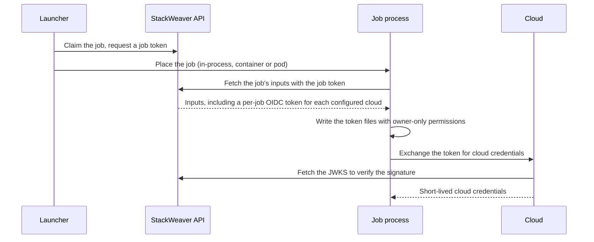

# Workload Identity

A job that changes cloud resources needs a cloud identity. StackWeaver gives every OpenTofu run and Ansible job an identity of its own, the **platform identity**, without storing a cloud secret anywhere and without lending the job the identity of the machine it runs on. This guide explains how that works and what you set up for it.

## The Platform Identity

For every job, the API mints a short-lived token signed with the installation's OIDC signing key, one for each target the organization has an OIDC configuration for: Azure, AWS, GCP and HashiCorp Vault. The token names the organization, project and workspace or job it was minted for, so the cloud's trust policy decides exactly which jobs may assume which role. The token travels to the job with the rest of its inputs, over the job's own token, and is valid only for a short time.

<strong>Flow Steps (Legend)</strong>

1. **Claim** - The launcher claims the job and receives a token valid for that job alone.
2. **Placement** - The launcher's driver starts the job's process; the launcher never sees the job's credentials.
3. **Inputs** - The job's process fetches the job's inputs, and the API mints the OIDC tokens for the clouds the organization configured.
4. **Materialize** - The job's process writes each token where the cloud's SDK looks for it and sets the matching variables, in a directory that exists for this job and is removed when it ends.
5. **Exchange** - The cloud verifies the token against StackWeaver's published keys and returns credentials scoped by its trust policy.

The platform identity is the same on every driver and every pool, the hosted capacity included, and it is what every job uses unless it selects something else. It works for both engines: an OpenTofu run and an Ansible job each receive the tokens of all four targets the organization configured, and an Azure dynamic inventory source sync receives an Azure token (see [Dynamic Inventories](./dynamic-inventories.md)). On an Ansible job, an Azure credential attached to the job takes precedence over the organization's Azure configuration.

## Setting It Up

Each target needs a trust on its side and a registration in StackWeaver. [OIDC Configuration](./oidc-configuration.md) walks through each of them: an Azure App Registration with a federated credential, an AWS IAM OIDC provider and role, a GCP Workload Identity Pool, or a Vault JWT auth role, each registered with its `tfe_*_oidc_configuration` resource. It also lists the token subjects your trust policies match on and the variables a job receives.

The cloud must reach the installation's issuer to verify a token, so the issuer (`OIDC_ISSUER_URL`) must be publicly reachable with a publicly trusted certificate. Only the API holds the signing key (`OIDC_SIGNING_KEY`); launchers and jobs never do.

## What a Job Receives

The job's process turns each token into what the cloud's SDK and Terraform providers already read. For AWS it writes the token to a file and sets `AWS_ROLE_ARN`, `AWS_WEB_IDENTITY_TOKEN_FILE` and `AWS_ROLE_SESSION_NAME`. For GCP it writes the token and an external-account credential configuration and sets `GOOGLE_APPLICATION_CREDENTIALS`. For Vault it logs in to the JWT auth method itself and sets `VAULT_ADDR` and `VAULT_TOKEN`. For Azure it sets the `ARM_*` variables the `azurerm` provider reads with `ARM_USE_OIDC=true`, and for Ansible jobs also `AZURE_CLIENT_ID`, `AZURE_TENANT_ID` and `AZURE_SUBSCRIPTION_ID`. [OIDC Configuration](./oidc-configuration.md) has the full list per cloud.

A target the organization has not configured receives no token. A job then has no cloud identity from StackWeaver and authenticates only with what its variables or attached credentials provide.

## Why the Node's Identity Stays Out of Reach

A job never inherits the cloud identity of the VM or node it runs on. On the container and Kubernetes drivers, a launcher in the default `platform` network mode blocks the cloud metadata ranges (`169.254.0.0/16`, `fd00:ec2::/64` and `fd20:ce::/64`) from every job, which is where an instance profile, a managed identity or a VM service account would come from. Azure's platform address `168.63.129.16` stays blocked in every network mode. On the container driver, every job also checks at start whether a metadata endpoint answers and refuses to run if one does, so a host whose firewall could not be programmed, such as rootless Podman, fails closed. A job pod never uses the host network and carries no ServiceAccount token unless an identity binding needs one.

The in-process driver does not isolate the network: a job of an in-process launcher can reach whatever its host can, including the host's metadata endpoint. Use the container or Kubernetes driver for any pool where that matters. See [Set up launchers](./self-hosted-runners.md#network-modes).

## Other Identity Options

Two further options exist for launchers you run yourself:

- An agent pool whose launchers use the Kubernetes driver can offer **identity bindings**. A binding runs the pool's job pods as a ServiceAccount that a cloud's pod identity mechanism trusts (`aws-irsa`, `aws-pod-identity`, `gcp-workload-identity` or `azure-workload-identity`). The hosted capacity offers no bindings. [Set up launchers](./self-hosted-runners.md#identity-bindings) describes how bindings are created and selected.
- Whoever installs a launcher can set the `host-identity` network mode on its container or Kubernetes driver. It leaves the metadata endpoints open, so jobs use the node's own identity. A strict hosted deployment refuses this mode.

Stackweaver does not document the cloud-side setup of these options as a supported configuration. Use the platform identity described above, which works the same for every cloud, every driver and the hosted capacity.
